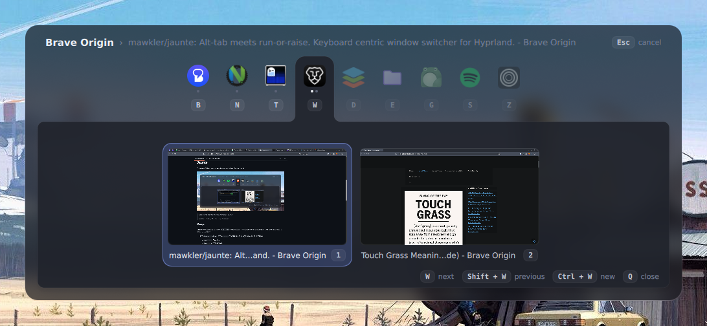

# Jaunte

The most efficient way to move between windows. For Hyprland.



> *Cogito ergo jaunteo. I think, therefore I jaunte.*
>
> — Alfred Bester, *The Stars My Destination*

## Usage

Jaunte works similarly to classic `Alt + Tab` switchers, but it is scoped to only one program's windows at a time. To switch to a window:

1. Press `Super + <key>`, where `<key>` is the program to jump to, configured by you. For example:

   - `Super + t`: **T**erminal
   - `Super + w`: **W**eb browser
   - `Super + s`: **S**potify
   - etc...

2. Keep holding down `Super` and tap `<key>` again to cycle to that program's next window
3. Release `Super` to go to the selected window

## Motivation

The goal of Jaunte is to make it effortless to switch between windows in a keyboard-centric way. "Take me to window X".

The good thing with `Alt + Tab` switchers is that they make it very easy to switch to your most recent windows. But they don't scale that well when you have a lot of windows open. The more windows, the more times you need to press `Tab` to get to less recent windows. Moreover, with a lot of windows you have to hunt-and-peck and search with your eyes for the right window to land on. Because Jaunt scopes window switching to one program, it significantly dampens that growth.

### Why not use Hyprland workspaces?

*Why not just put your web browser on workspace 1, and press `Super + 1` to switch to it?*

That works as long as you always have one program per workspace. What if you have multiple windows on the same workspace? What if you want to view your terminal alongside your web browser? Suddenly you can't jump to one of them with one single key press.

Tiling compositors/window managers are great at managing your window layouts, but they don't necessarily make it easier to switch between any two windows.

## Installation

### NixOS

<details>
<summary><b>Click to expand</b></summary>

```nix
# flake.nix
{
  inputs.jaunte.url = "github:mawkler/jaunte";
}
```

```nix
# ...then in your NixOS configuration:
{
  imports = [ inputs.jaunte.nixosModules.default ];

  services.jaunte = {
    enable = true;
    # If you prefer configuring with Nix (doesn't hot-reload)
    # settings = {
    #   keys.apps = {
    #     t = "ghostty";
    #     w = { cmd = "brave"; app_id = "brave-browser"; };
    #   }
    #   # ...
    # };
  };
}
```

This runs the daemon as a user service, which needs the session in systemd, e.g. `programs.hyprland.withUWSM = true`. Without `settings` it reads `~/.config/jaunte/config.toml` (which supports hot-reloading). See [Configuration](#configuration) for mor info.

</details>

### Other Linux distros

<details>
<summary><b>Click to expand</b></summary>

1. Install Jaunte:

    ```sh
    git clone https://github.com/mawkler/jaunte
    cargo install --path jaunte
    ```

2. Add this to your `~/.config/hypr/hyprland.lua`:

```lua
hl.on("hyprland.start", function() hl.exec_cmd("jaunte daemon") end)
```

</details>

## Configuration

Configuration is in `~/.config/jaunte/config.toml`, and it hot-reloads Jaunte on save.

`jaunte default-config` prints [the default config](src/config/default-config.toml).

Example configuration:

<details>
<summary><b>Click to expand</b></summary>

```toml
[keys]
next = "Tab"             # only bound while the switcher is open; Super is implied
previous = "Shift + Tab"
cancel = "Escape"
close = "q"              # close the highlighted window; unset by default

[keys.apps] # Super + key
t = "ghostty"
s = "spotify"
w = { cmd = "brave", app_id = "brave-browser" } # when the window class isn't the command
"Shift + a" = "teams"                           # a key may carry modifiers, but then has no Shift to go back with

[switcher]
delay = 90                      # milliseconds Super is held before the switcher appears
width = "50%"                   # of the screen, or pixels
max_height = "40%"              # previews shrink to fit
icons = true                    # icons rather than initials
background_opacity = 0.92       # the panel
foreground_opacity = 1          # the sheet holding the windows
theme = "default"
numbers = { action = "select" } # or "switch": a number key goes to its window at once

[previews]
enabled = true
height = 150   # pixels

[names] # by window class; otherwise the desktop entry's name
brave-browser = "Brave"
```

</details>

### Themes

The built-in themes live in [`themes/`](themes), and includes `default`, `light`, `catppuccin`, `nord`, `one-dark` and `tokyo-night`.

To create your own, put it in `~/.config/jaunte/themes/<name>.toml`, and set `theme = "<name>"` (or a path) in your config.

A theme only needs the colors it changes. The rest come from its `base`, or from `default` if it doesn't have one.

```toml
base = "nord"          # optional: the theme to start from
background = "#15171c" # the panel
surface = "#20232b"    # the sheet and its tab
accent = "#6b8cff"     # the selected window
text = "#c4cad8"       # window titles and keys
bright = "#eef1f7"     # the heading and the selected window's title
muted = "#78819a"      # secondary text and hints
```

A theme can also go straight into your config, written the same way:

```toml
[switcher.theme]
base = "nord"
accent = "#ff8800"
```

## Development

To set up the development environment (requires [Nix](https://nixos.org/download/)), run

```sh
nix develop
```

The switcher's QML in `shell/` is built into the binary. `JAUNTE_SHELL=$PWD/shell jaunte daemon` runs it from the checkout instead, reloading on every save.

## AI disclosure

This project started out as hand-chiseled. I have since pivoted to relying heavily on agentic LLMs.
